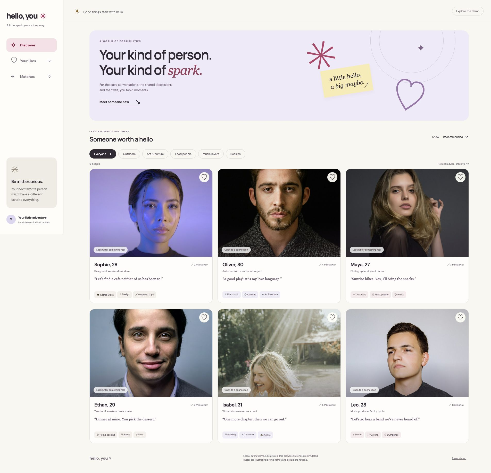
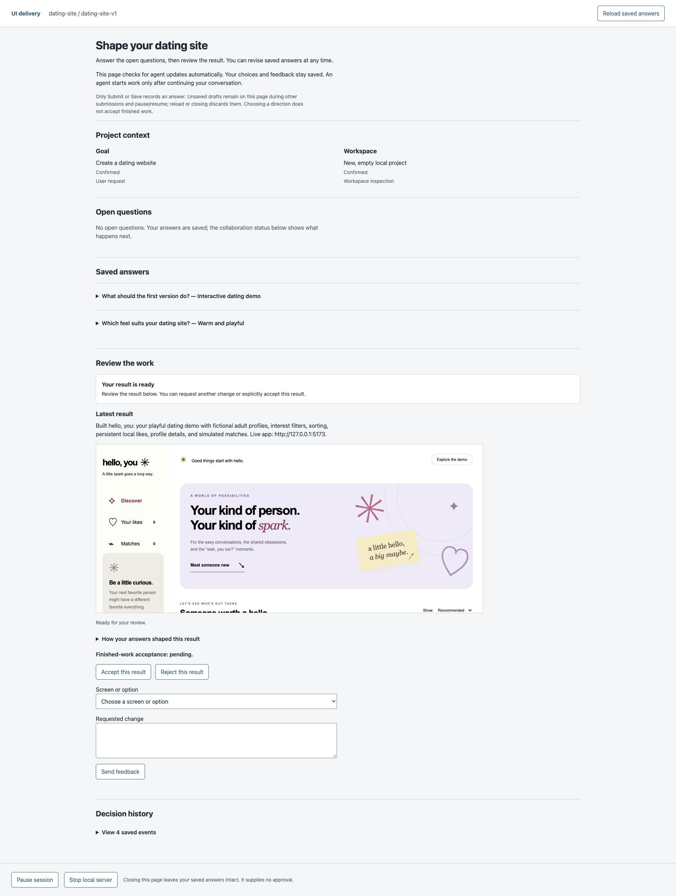

# Example: hello, you

Captured from the user-supplied local previews on 2026-10-11 for this private peer repository, alongside ui-delivery 0.10.0.

## App

The Discover screen combines a warm, playful visual direction with interest filters, sorting and fictional profile cards. The screenshot shows six profiles and zero likes/matches in the capture browser. Names, ages, distances and profile details are fictional; portraits are illustrative. Matches in this demo are simulated.

## Onboarding and review

The saved answers select “Interactive dating demo” and “Warm and playful.” The result is ready for review, with finished-work acceptance still pending in the captured state. The embedded result is a static, scriptless preview; the app runs separately.

The browser saves replies and checks for recorded agent updates. It does not launch or notify a coding agent; users continue the agent conversation after submitting. No watcher was added for this release.

## Capture scope

Full-page JPEGs were captured in Chrome at its existing viewport, without altering app content or submitting any choices, likes, feedback or acceptance. The first review capture omitted the offscreen embedded preview; scrolling it into view before recapturing produced the image above. The original attempt remains in the local delivery evidence.

Sources were loopback URLs on the author's computer: app port 5173 and review port 51132. These addresses are not shareable hosted previews. This repository contains screenshots, not the dating app source or raw session records. Images were visually inspected before inclusion. No functional, accessibility or real-service certification is implied by these captures.
